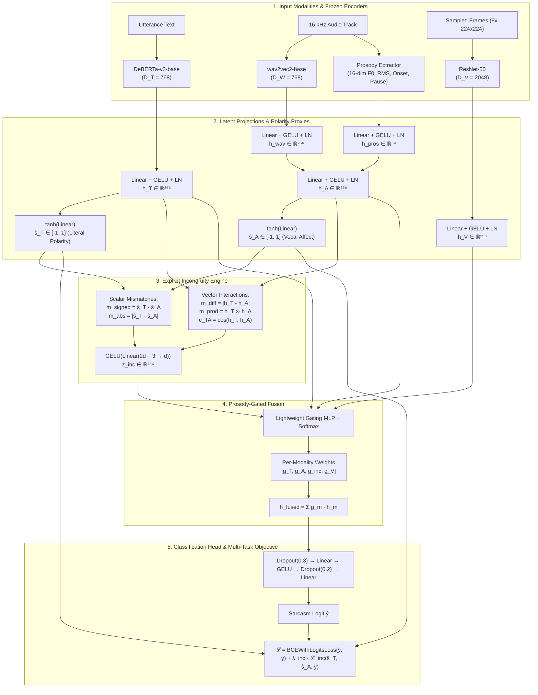

# SarcasTone: Multimodal Sarcasm Detection

[](https://pytorch.org/)
[](https://huggingface.co/transformers/)
[](https://colab.research.google.com/)
[](LICENSE)

An end-to-end deep learning framework for multimodal sarcasm detection across **Text**, **Speech Prosody + Acoustics**, and **Video**. SarcasTone implements the **Prosody-Gated Incongruity Network (PGIN-Sarcasm)**, designed to model the fundamental nature of sarcasm: **the lexical-acoustic incongruity between what is said and how it is delivered**.

Optimized for **Google Colab (T4 GPU)** with **Google Drive persistent caching**, allowing feature extraction once and fast, reproducible ablation experiments.

---

## 1. System Architecture: PGIN-Sarcasm

In sarcastic speech, lexical cues often project a positive or neutral literal sentiment (*"Oh, what a brilliant idea"*), while acoustic cues (flat pitch, prolonged pauses, exaggerated emphasis) communicate disdain or mock enthusiasm. Traditional multimodal fusion methods naively concatenate modality vectors, which forces the classifier to infer this subtle cross-modal tension implicitly.

**PGIN-Sarcasm** explicitly extracts polarity mismatches, vector divergence, and cross-modal cosine alignment between text and speech, then employs a **prosody-aware soft gating network** to dynamically regulate the contribution of each modality branch.



---

## 2. Mathematical Formulation

### 2.1 Branch Representations & Polarity Proxies
Let latent projection dimension be $d = 256$:
* **Text Representation:**
  $$h_T = \text{LayerNorm}(\text{GELU}(W_T x_{\text{text}} + b_T)), \quad h_T \in \mathbb{R}^d$$
  $$\hat{s}_T = \tanh(w_s^T h_T + b_s) \in [-1, 1] \quad \text{(Literal sentiment proxy)}$$

* **Speech Representation (Acoustics + Explicit Prosody):**
  $$h_{\text{pros}} = \text{LayerNorm}(\text{GELU}(W_p x_{\text{pros}} + b_p)), \quad h_{\text{pros}} \in \mathbb{R}^{64}$$
  $$h_{\text{wav}} = \text{LayerNorm}(\text{GELU}(W_w x_{\text{audio}} + b_w)), \quad h_{\text{wav}} \in \mathbb{R}^d$$
  $$h_A = \text{LayerNorm}(\text{GELU}(W_A [h_{\text{wav}} \,;\, h_{\text{pros}}] + b_A)), \quad h_A \in \mathbb{R}^d$$
  $$\hat{s}_A = \tanh(w_a^T h_A + b_a) \in [-1, 1] \quad \text{(Vocal affect proxy)}$$

* **Video Representation:**
  $$h_V = \text{LayerNorm}(\text{GELU}(W_V x_{\text{video}} + b_V)), \quad h_V \in \mathbb{R}^d$$

### 2.2 Explicit Cross-Modal Incongruity
When both text and speech are active:
* **Polarity Mismatches:**
  $$m_{\text{signed}} = \hat{s}_T - \hat{s}_A, \qquad m_{\text{abs}} = |\hat{s}_T - \hat{s}_A|$$
* **Latent Distance & Alignment:**
  $$m_{\text{diff}} = |h_T - h_A|, \qquad m_{\text{prod}} = h_T \odot h_A, \qquad c_{TA} = \frac{h_T \cdot h_A}{\|h_T\|_2 \|h_A\|_2}$$
* **Incongruity Vector ($z_{\text{inc}} \in \mathbb{R}^d$):**
  $$z_{\text{inc}} = \text{GELU}(W_{\text{inc}} [m_{\text{diff}} \,;\, m_{\text{prod}} \,;\, m_{\text{signed}} \,;\, m_{\text{abs}} \,;\, c_{TA}] + b_{\text{inc}})$$

### 2.3 Modality Gating & Fused Representation
Given active branch vectors $H = [h_T \,;\, h_A \,;\, z_{\text{inc}} \,;\, h_V]$ with inactive branches zero-masked:
$$g = \text{Softmax}(W_g H + b_g) \in \Delta^3, \quad g = [g_T, g_A, g_{\text{inc}}, g_V]$$
$$h_{\text{fused}} = g_T h_T + g_A h_A + g_{\text{inc}} z_{\text{inc}} + g_V h_V \in \mathbb{R}^d$$

### 2.4 Multi-Task Incongruity Loss
$$\mathcal{L} = \text{BCEWithLogitsLoss}(\hat{y}, y) + \lambda_{\text{inc}} \cdot \mathcal{L}_{\text{inc}}(\hat{s}_T, \hat{s}_A, y)$$
$$\mathcal{L}_{\text{inc}} = y \cdot \max(0, \, \delta - |\hat{s}_T - \hat{s}_A|) + (1 - y) \cdot |\hat{s}_T - \hat{s}_A|$$
where $\delta = 0.5$ is the incongruity margin and $\lambda_{\text{inc}} = 0.1$ regularizes the polarity proxies to diverge under sarcastic utterances ($y=1$) while aligning under non-sarcastic utterances ($y=0$).

---

## 3. Multimodal Feature Extraction & Modalities

| Modality | Pretrained Encoder / Extractor | Dimension | Description & Preprocessing |
| :--- | :--- | :--- | :--- |
| **Text** | `microsoft/deberta-v3-base` | `(768,)` | Attention-masked mean pooling over last hidden states of target utterance (optionally prefixed with context). |
| **Speech Acoustic** | `facebook/wav2vec2-base` | `(768,)` | Temporal average pooling over last hidden states from 16 kHz mono audio. |
| **Speech Prosody** | `librosa` / `scipy` | `(16,)` | 16-dimensional engineered acoustic vector capturing pitch, dynamics, rhythm, and silence patterns. Fit with `ProsodyScaler` on train split. |
| **Video** | `torchvision.models.resnet50` | `(2048,)` | Temporal average pooling across 8 uniformly sampled frames (224x224 RGB, ImageNet normalized). |

### Explicit 16-Dimensional Prosody Feature Breakdown
1. **Fundamental Frequency ($F_0$ / Pitch via `librosa.yin`):** voiced mean, voiced std, voiced min, voiced max, voiced dynamic range ($F_{0,\max} - F_{0,\min}$), linear pitch slope over voiced frames, voiced frame ratio (7 dims).
2. **Energy & Intensity (`librosa.feature.rms`):** RMS mean, RMS std, RMS max, dynamic range ($\text{max} - \text{mean}$), linear energy slope (5 dims).
3. **Speaking Rate & Rhythm:** onset detection rate per second, zero-crossing rate (ZCR) mean (2 dims).
4. **Silence & Pauses:** silence frame ratio below threshold energy, total duration in seconds (2 dims).

---

## 4. Google Colab (T4 GPU) & Drive Caching Workflow

Colab free/Pro environments face session timeouts, CPU disk bottlenecks, and GPU allocation limits. SarcasTone decouples heavy pretrained feature extraction from iterative model training:

```text
[Google Drive Persistent Storage]
   ├── data/ (raw MUStARD clips + annotations)
   ├── cache/ (offline extracted .pt tensors + locked splits.json)
   └── results/ (checkpoints, metrics.json, confusion matrices, ablation_summary.csv)
```

1. **Stage 1: Offline Feature Extraction (`notebooks/01_extract_and_cache_colab.ipynb`)**
   * Mounts Google Drive (`/content/drive/MyDrive/SarcasTone`).
   * Loads `microsoft/deberta-v3-base`, `facebook/wav2vec2-base`, and `ResNet50` on the T4 GPU.
   * Extracts and saves `text_emb`, `audio_emb`, `prosody_vec`, and `video_emb` tensors to `cache/{utterance_id}.pt`.
   * **Extracted once; subsequent restarts load tensors directly in milliseconds.**

2. **Stage 2: Modular Training & 8-Run Ablation Evaluation (`notebooks/02_train_and_evaluate_colab.ipynb`)**
   * Loads cached feature tensors from Google Drive.
   * Employs mixed precision (`fp16` via `torch.amp.autocast`) and AdamW optimizer.
   * Standardizes prosody vectors using `ProsodyScaler` fit strictly on the training partition.
   * Executes the full 8-run ablation matrix in under 15 minutes on a single T4 GPU.

---

## 5. The 8-Run Modality Ablation Matrix

To isolate the individual and joint contributions of text, acoustics, prosody, and visual cues, SarcasTone executes an **8-run ablation matrix** evaluated on **strictly identical, locked splits (`splits.json`)**:

| # | Run Name | Active Modalities | Fusion Mode | Research Hypothesis & Purpose |
| :-: | :--- | :--- | :--- | :--- |
| **1** | `text_only` | `["text"]` | `pgin` | Lexical-only baseline. Establishes the upper bound of text semantics without acoustic or visual context. |
| **2** | `speech_only` | `["speech"]` | `pgin` | Acoustic + prosody baseline (wav2vec2 + 16-dim prosodic vector). Measures sarcasm detection from vocal tone alone. |
| **3** | `video_only` | `["video"]` | `pgin` | Visual-only baseline (ResNet50). Assesses whether facial expressions and gestures alone carry sarcasm signals. |
| **4** | `text_speech_concat` | `["text", "speech"]` | `concat` | **Ablation Baseline:** Naive linear concatenation $[h_T \,;\, h_A] \rightarrow d$. Bypasses incongruity and gating. |
| **5** | `text_speech_pgin` | `["text", "speech"]` | `pgin` | **Core Hypothesis:** Evaluates the exact performance gain of explicit incongruity modeling and prosody gating over naive concatenation. |
| **6** | `text_video` | `["text", "video"]` | `pgin` | Evaluates bimodal text and visual gesture interaction without acoustic cues. |
| **7** | `speech_video` | `["speech", "video"]` | `pgin` | Evaluates bimodal non-verbal cues (vocal affect + visual expression) without transcript text. |
| **8** | `full_multimodal_pgin` | `["text", "speech", "video"]` | `pgin` | **Full SarcasTone Network:** Jointly integrates text, speech prosody, acoustics, and video with dynamic modality gating. |

---

## 6. Repository Structure

```text
SarcasTone/
├── docs/
│   ├── SRS.md                   # Software Requirements Specification
│   └── SRD.md                   # System Architecture & Design Specification
├── configs/
│   └── default.yaml             # Hyperparameters, encoder backbones, paths, and ablations
├── src/
│   ├── __init__.py              # Package init
│   ├── data/
│   │   ├── __init__.py          # Data module exports
│   │   ├── dataset.py           # Ingestion, deterministic splitting, and cached feature dataset
│   │   └── collate.py           # Multimodal batch collation & modality masking
│   ├── features/
│   │   ├── __init__.py
│   │   ├── text_features.py     # DeBERTa-v3 text embedding extractor
│   │   ├── prosody_features.py  # Librosa 16-dim prosody + wav2vec2 acoustic extractor
│   │   ├── video_features.py    # ResNet-50 video frame extractor
│   │   └── cache_manager.py     # Google Drive feature cache persistence
│   ├── models/
│   │   ├── __init__.py
│   │   ├── incongruity_gate.py  # Polarity mismatch, vector divergence, & gating MLP
│   │   └── pgin_sarcasm.py      # End-to-end PGIN-Sarcasm PyTorch module
│   ├── training/
│   │   ├── __init__.py
│   │   ├── losses.py            # BCE + Multi-task incongruity margin loss
│   │   ├── trainer.py           # Mixed-precision (fp16) training loop with early stopping
│   │   └── metrics.py           # F1, Accuracy, Precision, Recall, Confusion Matrix
│   └── experiments/
│       └── run_ablations.py     # Automated execution of 8-run ablation matrix
├── notebooks/
│   ├── 01_extract_and_cache_colab.ipynb  # Drive mount, dependency install, feature extraction
│   └── 02_train_and_evaluate_colab.ipynb # Split verification, ablation runner, metric charts
├── scripts/
│   ├── verify_splits.py         # Split leakage verification & ablation consistency check
│   └── smoke_test.py            # End-to-end synthetic smoke test (forward pass, loss, 8 ablations)
├── tests/
│   ├── __init__.py
│   ├── test_dataset_and_splits.py # Pytest test suite for data pipeline & split integrity
│   ├── test_features.py           # Unit tests for feature extractors & cache manager
│   └── test_notebooks_and_smoke.py# Validation of Colab notebooks schema & smoke test
├── requirements.txt             # Locked Python dependencies
├── .gitignore                   # Excludes raw media, cached tensors, logs, checkpoints
└── README.md                    # System documentation
```

---

## 7. Quickstart Guide

### 7.1 Local / Development Setup
```bash
git clone https://github.com/Tanmay-Shrivastav/SarcasTone.git
cd SarcasTone
python -m venv venv
# Linux / macOS
source venv/bin/activate
# Windows PowerShell
.\venv\Scripts\Activate.ps1

pip install -r requirements.txt
```

### 7.2 Launch the Interactive Web Application
Launch the live, interactive web application featuring real MUStARD sarcasm clips, live PGIN model inference, and the 8-run ablation benchmark:
```bash
python run_app.py
```
Open **`http://localhost:8000`** in your browser.

To run the automated verification suite for all endpoints, assets, and checkpoints:
```bash
python run_app.py --test
```

### 7.3 Cloud Deployment (Render & Vercel)

#### Option A: Full-Stack Deployment on Render (FastAPI + Frontend)
Deploy the full-stack web application on Render's free tier (stays well within 512 MB RAM using the lightweight direct inference engine):
1. Create a new **Web Service** on [Render](https://render.com) connected to your repository.
2. Configure settings:
   - **Environment:** `Python`
   - **Build Command:** `pip install -r requirements-deploy.txt`
   - **Start Command:** `uvicorn api.server:app --host 0.0.0.0 --port $PORT`
   - **Health Check Path:** `/api/health`
3. Render automatically binds `$PORT` and serves both the API endpoints (`/api/predict`, `/api/results`, `/api/samples`) and the editorial frontend.

#### Option B: Static Frontend Deployment on Vercel
1. Import the repository on [Vercel](https://vercel.com).
2. Set **Root Directory** to `frontend`.
3. To connect to an external Render backend, either:
   - Specify `window.SARCASTONE_API_BASE = "https://your-app.onrender.com"` in `frontend/index.html`, or
   - Pass the URL parameter in your browser: `https://your-site.vercel.app/?api=https://your-app.onrender.com`
   - Even without an active backend, the site operates 100% interactively via the precomputed `frontend/data/demo_data.json` bundle.

### 7.4 Verify Dataset Splits (Zero Leakage Check)
Before training, verify that the dataset splits guarantee strictly zero overlap between train, validation, and test sets:
```bash
python scripts/verify_splits.py --config configs/default.yaml
```

To run an automated verification test using synthetic mock samples:
```bash
python scripts/verify_splits.py --demo-mode --splits-file tests/temp_splits.json
```

Run test suite:
```bash
pytest tests/
```

### 7.5 Run End-to-End Smoke Test (Zero Downloads Required)
Verify model forward passes, multi-task incongruity loss, metric tracking, and all 8 ablation runs using synthetic dummy tensors and cached files:
```bash
python scripts/smoke_test.py
```
On a GPU runtime (or Google Colab T4), run:
```bash
python scripts/smoke_test.py --device cuda
```

### 7.4 Google Colab Execution
1. Open `notebooks/01_extract_and_cache_colab.ipynb` in Google Colab.
2. Select **Runtime > Change runtime type > T4 GPU**.
3. Execute the cells to mount Google Drive, extract features, and save `.pt` tensors.
4. Open `notebooks/02_train_and_evaluate_colab.ipynb` to run the 8-run ablation matrix and inspect performance comparisons across modalities.

---

## 8. License & Citation

This project is licensed under the MIT License. See [LICENSE](LICENSE) for details.

If you use SarcasTone or the PGIN architecture in your research, please cite:
```bibtex
@article{sarcastone2026,
  title={SarcasTone: Multimodal Sarcasm Detection via Prosody-Gated Incongruity Networks},
  author={SarcasTone Research Team},
  year={2026}
}
```
